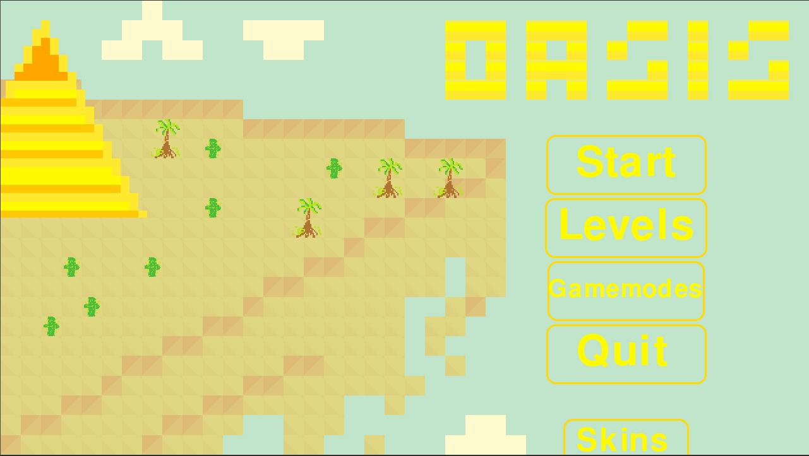

# Oasis Searcher

# Goal of the game :
 A world of dessert where you must find oasis before your hydration level turn 0 and die of thirst.
 Traverse through obstacles, use your pathfinding to avoid cacti and use wells cleverly to reflenish and manage your hydration.

 Halloween Update
 Outside of the main game, find the secrets of the dark forest

# Why I made this game
There are plenty reasons but the most imporant in my opinion is the learnings I made and will make along the way. I am a begineer and this is a great experience for me to develop my passion for coding and problem solving. The reason why I did this game is I just generally think of it, oasis was on my mind that day and I say why not

# Game Rules 
-You have a limited time to find the oasis

- Avoid obstacle
- Use W,A,S,D to move
- press space to pause
- press shift to run

# Current Features :
Overview 
- map
- camera
- collision
- obstacle
- Thirst mechanics
- Oasis Mechanics (reach and find it to win)
- Well mechanics
- cactus damage system
- level selection

Changelog :
version 2
week 1
- menu system
- Modified Assets
- Animations
- retry button
- return button
- Pause Menu
- Timer Modifications
- Level System 
currently only 3 levels for now

version 3 
Week 2
Major updates 
- Level selection system
- Level selection menu
- Hydration bar synced with timer 
- Proper hud
- Replenishing mechanics for Hydration 
- Wells for water
-  Cactus damages
- Sprint Mechanics (timer speeds up)

Minor updates
- Modified Retry system 
- Retry at your current level 
- Multiple Timer for each respective level 
- Dead State implemented 
- Improved main menu buttons 
- Added back button to level
- Updated oasis assets
- Instruction to pause and sprint now on top 
- 2 extra Levels

HALLOWEEN UPDATE (dont read this unless you want to head in to the game unspoiled)
Major updates :
- Halloween special level (Added a gamemode for it)
- Beast mechanics 
- Chase sequence 
- trigger for spawning it
- beast targeting the player
- Fake Oasis
- Music 
- Changing Ambience


Minor updates
- New assets for Halloween 
- Beast does not sync with the player speed now, it uses a fix speed 
- Beast does not move now if paused
- menu image change to dark mode 
- Beast spawning warning text


WEEK 4 update:

Major Features

-  Gamemode Selection
  
  - Has preview of selecting the gamemode
  - Halloween gamemode for now

-  Character Skin System
  
  - Skin of character interchangeable
  - Save system for characterskin
  - Skin save data synced with Halloween gamemode

-  Desert Traps and Hazards
  
  - Quick sand (slow walking)
    - Can't Sprint if stuck on quicksand
  - Sand trap
    - Trapped text and countdown
  - Mirage oasis
    - Fading mirage text
  - Heat wave (effects)
    - Heat damages
    - Heat effects (super transparent red overlay)

-  Water Bottles
  
  - Water bottles (collectibles) HUD, "1" to use

Minor Improvements

-  Hydration Ambiance
  
  - 60s no effect
  - 30s yellow effect
  - 10s Blinking red

-  Menu and Controls
  
  - Menu being able to be selected by enter, up down keys
  - Enter key click next in victory and retry in lose
  - Unpaused using space

-  Audio
  
  - Sound effects and theme
  - Desert walk

-  Fading water bottle effect to indicate collection

-  Reset button to reset level

-  In Skin selection, Created a Title head("Choose your Skins")


# Coming Soon

-  improved level selection ui
- Save system
- Player Upgrade
- End of level rating
-  time taken
- gamemodes
(Eternal)
(Adventure mode, has a clue)
- boss fight level
-  enemies
- drops
- highest
- damage cactus
- More obstacles
- Different backgrounds 
- Water bottles

- Heat wave
- Mirage
- Insane level or similar to blue abd red ball game where they can replay the level at higher difficulty 
- Updated hud


# Gameplay
- wasd = movement
- shift = sprinting
- space = pause
- if you touch wells you regain 5 levels of thirst
- if you touch cactus you lose 3 levels of thirst continuosly


# How to play

Only Linux is currently supported

how :
download Oasis_Searcher

you can run it on your linux or run through commands by using

```bash
./Oasis_Searcher
```
dont forget to do 

chmod +x Oasis_Searcer 

to ensure bash access

Alternatively You can download source.zip

 Requirement
 - Python
 - Pygame- ce (important use pygame_ce instead of pygame)
 - pytmx

You can copy this repository and execute 

```bash
main.py
```


For Windows :
coming soon (attempting to borrow laptop windows)

# NOTE : I am new in game dev and coding, so please dont judge me for inefficient coding and do contact me if there are issues and problems
