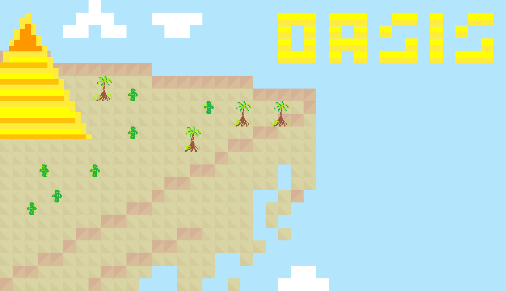

# Oasis Searcher

# Goal of the game :
 A world of dessert where you must find oasis before your hydration level turn 0 and die of thirst.

# Game Rules 
-You have 60 s to find the oasis

- Avoid obstacle
- Use W,A,S,D to move
-press space to pause

# Current Features :
- map
- camera
- collision
- obstacle
- Thirst mechanics
- Oasis Mechanics (reach and find it to win)

version 2
- menu system
- Modified Assets
- Animations
- retry button
- return button
- Pause Menu
- Timer Modifications
- Level System 
currently only 3 levels for now


# Planned Features for Next Update :
- Mini Oasis and wells (for repleneshing Thirst)
- Great Oasis (will be the main goal)
- Proper HUD
- Save system
- level Selection
- Player Upgrades
- End level rating with stars

# How to play

Only Linux is currently supported

how :
download Oasis_Searcher

you can run it on your linux or run through commands by using

```bash
./Oasis_Searcher
```
dont forget to do 

chmod +x main 

to ensure bash access

Alternatively You can download source.zip

 Requirement
 - Python
 - Pygame- ce
 - pytmx

You can copy this repository and execute 

```bash
main.py
```


For Windows :
coming soon (attempting to borrow laptop windows)

# NOTE : I am new in game dev and coding, so please do contact me if there are issues and problems
